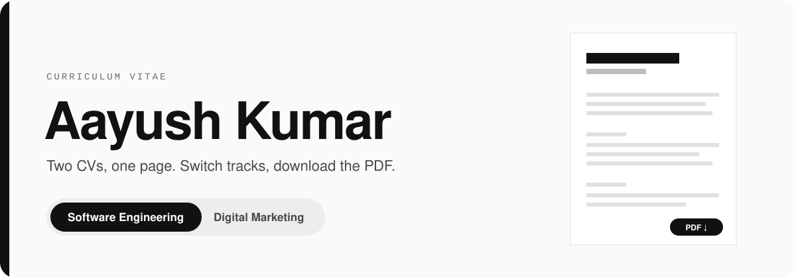

<p align="center"></p>

# Aayush Kumar CV

<p align="center">
  
  
  
  
  <br><a href="https://itsaayush2004.github.io/My-Cv/"><b>Open it live →</b></a>
</p>

A single page with all three of my CVs. Switch between **Software Engineering**, **Game Development** and **Digital Marketing**, or download any of them as PDF or Word.

- Live: https://itsaayush2004.github.io/My-Cv/
- Direct links: `/My-Cv/#software`, `/My-Cv/#game` and `/My-Cv/#marketing`

## Files

| Version | PDF | Word | Plain text |
|---|---|---|---|
| Software Engineer (backend, full-stack, AI) | [PDF](cv/Aayush_Kumar_CV_Software_Engineer.pdf) | [DOCX](cv/Aayush_Kumar_CV_Software_Engineer.docx) | [TXT](cv/Aayush_Kumar_CV_Software_Engineer.txt) |
| Game Developer (Unity, HTML5, multiplayer) | [PDF](cv/Aayush_Kumar_CV_Game_Developer.pdf) | [DOCX](cv/Aayush_Kumar_CV_Game_Developer.docx) | [TXT](cv/Aayush_Kumar_CV_Game_Developer.txt) |
| Digital Marketing (social, content, video) | [PDF](cv/Aayush_Kumar_CV_Digital_Marketing.pdf) | [DOCX](cv/Aayush_Kumar_CV_Digital_Marketing.docx) | [TXT](cv/Aayush_Kumar_CV_Digital_Marketing.txt) |

Use the PDF by default, the Word file when a portal asks for .doc/.docx, and the text file for "paste your resume" boxes.

## Built to pass ATS filters

- One column, one A4 page, real selectable text, standard headings (Summary, Skills, Experience, Projects, Education)
- Real bullet characters, plain-text URLs, no icons, tables or text in images
- Job-post wording in the headline, summary and skills, so keyword searches for "Software Engineer", "Unity Developer" or "Social Media Marketing" find it
- Action-verb bullets with real numbers only: nothing invented

## Updating

All three versions, and the web page, come from one file: `tools/cv-content.js`. Edit it, then rebuild:

```bash
NODE_PATH=$(npm root -g) node tools/build-cv.js
```

This rewrites the PDFs, Word and text files in `cv/` and the generated parts of `index.html`. The build picks the largest font that keeps each PDF on one page, and fails if a version no longer fits.
