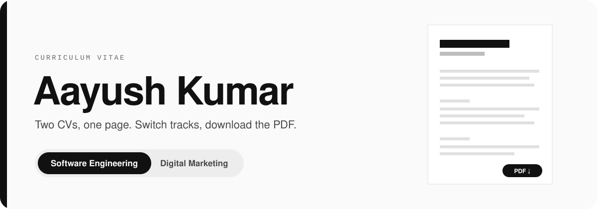

# Aayush Kumar CV

  
  
  
   <a href="https://itsaayush2004.github.io/My-Cv/"><b>Open it live →</b></a>

A single page with both of my CVs. Switch between **Software Engineering** and **Digital Marketing**, or download either as PDF.

- Live: https://itsaayush2004.github.io/My-Cv/
- Direct links: `/My-Cv/#software` and `/My-Cv/#marketing`

To update a CV, replace the PDF in `cv/` and edit the matching `<article>` in `index.html`.
